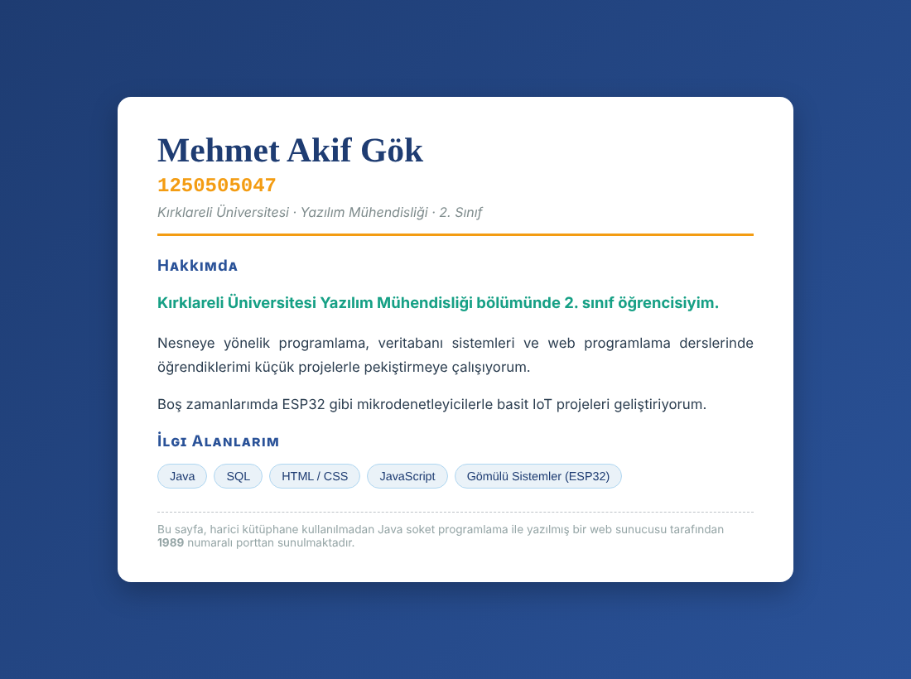

# Java Socket ile Basit Web Sunucusu

Harici hiçbir kütüphane veya framework kullanılmadan, yalnızca Java standart kütüphanesi (`java.net`, `java.io`, `java.util.concurrent`) ile yazılmış basit bir HTTP web sunucusudur. Sunucu **1989** numaralı portu dinler ve bir web tarayıcısı bağlandığında öğrencinin adını, numarasını ve biçimlendirilmiş kısa bir biyografisini içeren HTML sayfasını döndürür.



## İçindekiler

- [Özellikler](#özellikler)
- [Gereksinimler](#gereksinimler)
- [Kurulum ve Çalıştırma](#kurulum-ve-çalıştırma)
- [Proje Yapısı](#proje-yapısı)
- [Nasıl Çalışır?](#nasıl-çalışır)
- [SOLID Prensipleri](#solid-prensipleri)
- [Kişisel Bilgilerin Düzenlenmesi](#kişisel-bilgilerin-düzenlenmesi)

## Özellikler

- `ServerSocket` ile 1989 numaralı portun dinlenmesi
- HTTP/1.1 istek satırı ve başlıklarının elle ayrıştırılması
- `ExecutorService` iş parçacığı havuzu ile aynı anda birden fazla istemciye hizmet
- `<h1>` ile ad soyad, `<h2>` ile öğrenci numarası
- Renk, yazı tipi ve kutu stilleri ile biçimlendirilmiş biyografi sayfası
- 404 (sayfa bulunamadı), 405 (izin verilmeyen metot) ve 400 (hatalı istek) yanıtları
- HTML karakter kaçışı (escape) ile basit XSS önlemi
- SOLID prensiplerine göre ayrılmış paket ve sınıf yapısı

## Gereksinimler

- Java Development Kit (JDK) 8 veya üzeri
- Herhangi bir web tarayıcısı

Maven, Gradle veya başka bir bağımlılık **gerekmez**.

## Kurulum ve Çalıştırma

### 1. Depoyu klonlayın

```bash
git clone https://github.com/clanxDD/java-web-sunucu.git
cd java-web-sunucu
```

### 2. Derleyin

**Windows (PowerShell):**

```powershell
javac -encoding UTF-8 -d out (Get-ChildItem -Recurse -Filter *.java src).FullName
```

**Linux / macOS:**

```bash
javac -encoding UTF-8 -d out $(find src -name "*.java")
```

### 3. Çalıştırın

```bash
java -cp out com.ogrenci.webserver.Main
```

Konsolda aşağıdaki mesaj görünür:

```
Sunucu çalışıyor  -> http://localhost:1989
Durdurmak için Ctrl + C
```

### 4. Tarayıcıdan bağlanın

Tarayıcının adres çubuğuna şunu yazın:

```
http://localhost:1989
```

Aynı ağdaki başka bir cihazdan bağlanmak için `localhost` yerine sunucunun çalıştığı bilgisayarın IP adresini kullanın (örnek: `http://192.168.1.25:1989`).

> **IntelliJ IDEA ile:** Projeyi açın, `src` klasörüne sağ tıklayıp *Mark Directory as → Sources Root* seçin, ardından `Main.java` dosyasını çalıştırın.

## Proje Yapısı

```
java-web-sunucu/
├── README.md
├── docs/
│   └── ekran-goruntusu.png
└── src/com/ogrenci/webserver/
    ├── Main.java                     # Nesneleri oluşturur ve birbirine bağlar
    ├── config/
    │   └── ServerConfig.java         # Port ve iş parçacığı sayısı
    ├── server/
    │   ├── WebServer.java            # ServerSocket ile bağlantı kabul eder
    │   └── ClientHandler.java        # Tek bir istemcinin isteğini işler (Runnable)
    ├── http/
    │   ├── HttpRequest.java          # Ayrıştırılmış istek (metot, yol, başlıklar)
    │   ├── HttpRequestParser.java    # Ham metni HttpRequest nesnesine çevirir
    │   ├── HttpResponse.java         # Durum kodu, içerik türü, gövde
    │   ├── HttpResponseWriter.java   # Yanıtı HTTP formatında sokete yazar
    │   └── HttpStatus.java           # 200, 400, 404, 405, 500 kodları
    ├── handler/
    │   ├── RequestHandler.java       # Tüm handler'ların arayüzü
    │   ├── Router.java               # Adres -> handler eşleştirmesi
    │   ├── ProfilePageHandler.java   # Ana sayfa
    │   └── NotFoundHandler.java      # 404 sayfası
    ├── model/
    │   └── StudentProfile.java       # Öğrenci bilgileri
    └── view/
        ├── PageRenderer.java         # Sayfa üretici arayüzü
        └── HtmlProfileRenderer.java  # Biçimlendirilmiş HTML üretir
```

## Nasıl Çalışır?

1. `WebServer`, `new ServerSocket(1989)` ile portu açar ve `accept()` metodunda bağlantı bekler.
2. Tarayıcı bağlandığında `accept()` bir `Socket` nesnesi döndürür.
3. Bu soket bir `ClientHandler` nesnesine verilir ve iş parçacığı havuzunda çalıştırılır; ana döngü hemen yeni bağlantıları beklemeye döner.
4. `HttpRequestParser`, soketin giriş akışından `GET / HTTP/1.1` satırını ve başlıkları okur.
5. `Router`, istenen yola göre uygun `RequestHandler` nesnesini seçer.
6. `ProfilePageHandler`, `HtmlProfileRenderer` ile HTML sayfasını üretir.
7. `HttpResponseWriter`, durum satırını, başlıkları ve HTML gövdesini soketin çıkış akışına yazar.
8. Soket kapatılır; tarayıcı sayfayı görüntüler.

Örnek ham HTTP yanıtı:

```http
HTTP/1.1 200 OK
Server: JavaSocketWebServer/1.0
Content-Type: text/html; charset=UTF-8
Content-Length: 2734
Connection: close

<!DOCTYPE html>
<html lang="tr"> ...
```

## SOLID Prensipleri

| Prensip | Projedeki karşılığı |
| --- | --- |
| **S** – Tek Sorumluluk | Her sınıfın tek bir görevi vardır: `WebServer` bağlantı kabul eder, `HttpRequestParser` isteği ayrıştırır, `HttpResponseWriter` yanıtı yazar, `HtmlProfileRenderer` HTML üretir. |
| **O** – Açık/Kapalı | Yeni bir sayfa eklemek için mevcut kod değiştirilmez; `RequestHandler` arayüzünü uygulayan yeni bir sınıf yazılıp `Router`'a kaydedilir. |
| **L** – Liskov Yerine Geçme | `ProfilePageHandler` ve `NotFoundHandler`, `RequestHandler` beklenen her yerde sorunsuz kullanılabilir. |
| **I** – Arayüz Ayrımı | `RequestHandler` ve `PageRenderer` arayüzleri yalnızca tek bir metot içerir; sınıflar kullanmadıkları metotları uygulamak zorunda kalmaz. |
| **D** – Bağımlılığın Tersine Çevrilmesi | `ProfilePageHandler`, somut `HtmlProfileRenderer` yerine `PageRenderer` arayüzüne bağımlıdır; bağımlılıklar `Main` sınıfında dışarıdan verilir. |

## Kişisel Bilgilerin Düzenlenmesi

Ad soyad, öğrenci numarası ve biyografi metni `Main.java` dosyasındaki `StudentProfile` nesnesinde tanımlıdır:

```java
StudentProfile profile = new StudentProfile(
        "Ad Soyad",
        "Öğrenci No",
        ...
);
```

Bu değerleri kendi bilgilerinizle değiştirip projeyi yeniden derlemeniz yeterlidir.

## Lisans

Bu proje eğitim amaçlı hazırlanmıştır ve [MIT Lisansı](LICENSE) ile lisanslanmıştır.
